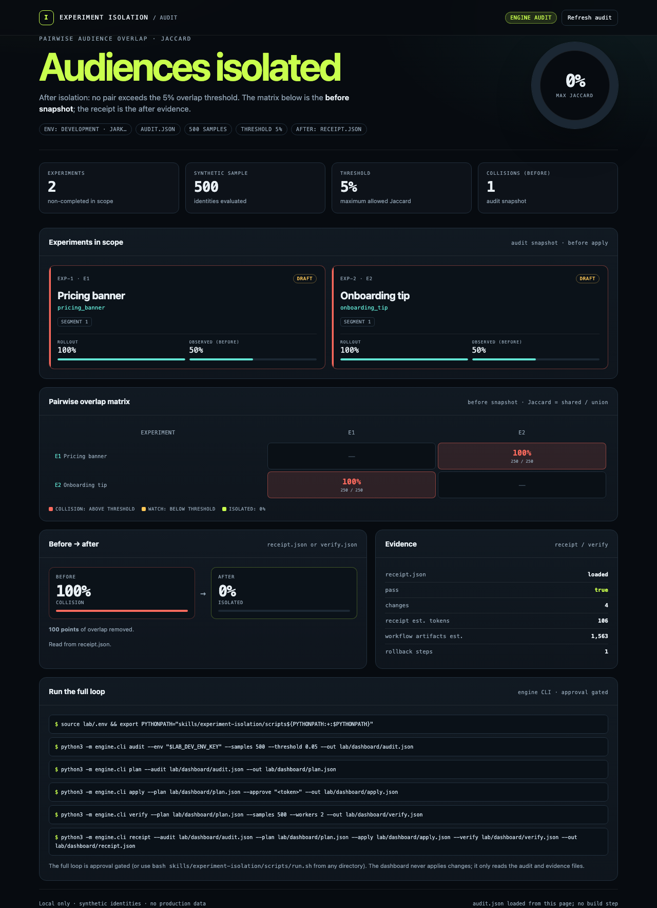
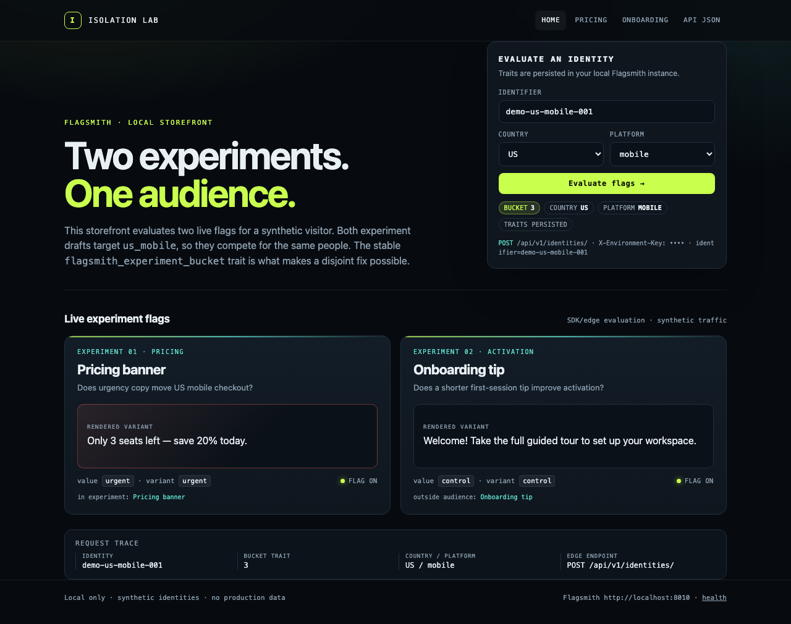

# Experiment Isolation

[](.github/workflows/ci.yml)
[](pyproject.toml)
[](LICENSE)
[](skills/experiment-isolation/SKILL.md)

Pre-launch audience collision detection, HMAC-gated mutual exclusion, and post-launch overlap verification for Flagsmith experiments—packaged as a self-contained Agent Skill, zero-dependency Python CLI, and self-hosted lab.

```console
$ experiment-isolation audit --env "$DEV_ENV_KEY" --samples 500 --threshold 0.05 --out audit.json
audit: 2 experiment(s), 1 collision(s), sample=500, verdict=collision -> audit.json
$ echo $?
10

$ experiment-isolation plan --audit audit.json --out plan.json
plan: feasible=True, 2 audience change(s), width=50, token=iso-4a8e91c2, before_jaccard=1.0 -> plan.json

$ experiment-isolation apply --plan plan.json --approve iso-00000000 --out apply.json
{"error":"Approval token does not match this plan; nothing was changed","exit_code":10}
refused: Approval token does not match this plan; nothing was changed
$ echo $?
10

$ experiment-isolation apply --plan plan.json --approve iso-4a8e91c2 --out apply.json
apply: 2 experiment(s) running; steps=6; segments created=2 reused=0; pass=True -> apply.json

$ experiment-isolation verify --plan plan.json --samples 500 --workers 2 --out verify.json
verify: before=1.0 after=0.0 pass=True sample=500 -> verify.json
$ jq '{after_jaccard, pass, segments: ["exp_iso_us_mobile_0_49", "exp_iso_us_mobile_50_99"]}' verify.json
{"after_jaccard":0.0,"pass":true,"segments":["exp_iso_us_mobile_0_49","exp_iso_us_mobile_50_99"]}

$ experiment-isolation receipt --audit audit.json --plan plan.json --apply apply.json --verify verify.json --out receipt.json
receipt: before=collision after=isolated pass=True -> receipt.json
$ python3 skills/experiment-isolation/scripts/token_count.py receipt.json
121
```

| Overlap dashboard (after 2-way isolation) | Live storefront (`demo-us-mobile-001`, bucket `3`) |
|---|---|
|  |  |

## The Problem & Isolation Layer

Running two or more experiments against overlapping audiences contaminates every readout: a user enrolled in both a pricing banner test and an onboarding tip test sees two simultaneous treatments, distorting conversion attribution across both experiments.

Flagsmith enforces hard structural constraints around experiment audiences:

- **Single-segment limit (`MAX_AUDIENCE_SEGMENTS = 1`):** Each experiment audience references at most one segment ID.
- **No percentage splits in audiences:** Flagsmith rejects audience segments containing `PERCENTAGE_SPLIT` rules.
- **Immutable started audiences:** Audiences cannot be edited while `experiment_rollout.enabled` is `true`, and once an experiment reaches `running` or `paused`, its audience is locked—pausing does not unlock audience edits.

**How pre-launch isolation preserves targeting rules:**

1. **Audit (`audit`):** Samples a deterministic synthetic cohort (`country`, `platform`, `flagsmith_experiment_bucket` in `0..99` via `sha256(identifier)[0:8] % 100`), persists traits via `flagsmith evaluate --persist --json`, reads Flagsmith's live enrollment (`metadata.experiment.in_experiment == true`) for active experiments, projects draft (`created`) eligibility from segment rules, and builds the pairwise N-way Jaccard and multi-exposure matrix. Exits `10` when collisions meet `--threshold` (default `0.05`).
2. **Compose (`plan`):** Partitions colliding draft components into disjoint, equal-width contiguous ranges across `0..99` (up to `--max-concurrent 4` and at least `--min-bucket-width 5`). Because each audience holds one segment, the planner extracts each draft's non-bucket targeting rules (such as `us_mobile`: `country = US AND platform = mobile`) and composes them with the bucket range into `exp_iso_<slug>_<lo>_<hi>` (for example, `exp_iso_us_mobile_0_49` and `exp_iso_us_mobile_50_99`). If a draft collides with an immutable `running` or `paused` experiment (or exceeds concurrency/width limits), `plan` sets `feasible: false` and exits `10` rather than planning partial isolation.
3. **Apply & Verify (`apply`, `verify`, `receipt`):** Validates the plan's HMAC approval token, creates or reuses composed segments, executes `disable rollout -> patch audience -> read-back verify -> start` for each draft, re-evaluates the paired 500-identity cohort against live Flagsmith Edge flags by default (or a fresh uncached prefix via `--sample-prefix`) to prove `after_jaccard == 0.0` (`pass: true`), and emits a compact JSON receipt.

## Quickstart

**Prerequisites:** Python 3.9+ (stdlib only, no runtime packages), the [Flagsmith CLI](https://docs.flagsmith.com/integrating-with-flagsmith/CLI) on `PATH` (or `FLAGSMITH_BIN`), and Docker with Compose v2 if running the self-hosted lab.

### Path 1: Agent Skill (standalone)

Copy `skills/experiment-isolation/` into your agent skills directory. The engine package is bundled under `skills/experiment-isolation/scripts/engine/`, so `scripts/run.sh` runs standalone from any project directory and writes relative `--out` artifacts to your current working directory (`$PWD`):

```sh
# Claude Code (or use ~/.codex/skills for Codex)
mkdir -p ~/.claude/skills
cp -R skills/experiment-isolation ~/.claude/skills/

export FLAGSMITH_API_URL="http://localhost:8010"
export FLAGSMITH_API_KEY="<admin-api-key>"
export DEV_ENV_KEY="<environment-key>"
export FLAGSMITH_ENVIRONMENT="$DEV_ENV_KEY"
export FLAGSMITH_PROJECT="1"

bash ~/.claude/skills/experiment-isolation/scripts/check_env.sh
bash ~/.claude/skills/experiment-isolation/scripts/run.sh audit --env "$DEV_ENV_KEY" --samples 500 --threshold 0.05 --out audit.json
```

Alternatively, run directly from the repository root (`python3 -m engine.cli ...` works via the root `engine/__init__.py` shim pointing to the canonical `skills/experiment-isolation/scripts/engine/`), use `skills/experiment-isolation/scripts/run.sh` standalone from any directory, or install the CLI entry point locally:

```sh
python3 -m engine.cli --help

# Or install the CLI entry point:
pip install -e .
experiment-isolation --help
```

### Path 2: Self-hosted Track 3 Lab

`make lab` (or `bash lab/run.sh`) boots an isolated Compose stack (`Flagsmith 2.291.0` on `:8010`, task processor on `:8011`, Postgres 15.5), bootstraps credentials into `lab/.env`, seeds two colliding `us_mobile` drafts (`pricing_banner` and `onboarding_tip`), runs an initial audit, and serves the storefront (`:8020`) and overlap matrix dashboard (`:8022`):

```sh
make lab        # or: bash lab/run.sh
make lab-demo   # boots lab + runs audit -> plan -> apply -> verify -> receipt
make lab-reset  # wipes and rebuilds the clean collision baseline
```

To seed colliding drafts against any configured local Flagsmith instance directly:

```sh
python3 seed/demo_seed.py --experiments 2
```

Run the test, lint, and skill validation suites (`116` pytest tests, including `42` skill contract tests):

```sh
make test       # pytest suite (116 tests across engine, lab, and skill)
make lint       # ruff check across engine, scripts, lab, seed, tests
make validate   # unittest skill packaging & contract checks (42 tests)
```

## How Flagsmith is Used & Safety Model

| Component | Usage |
|---|---|
| **Experiments** | Discovers non-completed experiments (`created`, `paused`, `running`), seeds colliding drafts, patches rollouts, and starts drafts via `POST /api/v1/environments/{env_key}/experiments/{id}/start/`. |
| **Audiences** | Reads and updates `{match, segment_ids}` within the `MAX_AUDIENCE_SEGMENTS = 1` constraint, always disabling the rollout before patching and refusing started experiments. |
| **Composed Segments** | Extracts existing non-bucket rules and composes them with `flagsmith_experiment_bucket` range rules (`GREATER_THAN_INCLUSIVE` / `LESS_THAN`) into `exp_iso_<slug>_<lo>_<hi>`. |
| **CLI `evaluate --persist`** | Persists synthetic identity traits (`country`, `platform`, `flagsmith_experiment_bucket`) and evaluates flags via `flagsmith evaluate --persist --json`, keeping credentials out of command `argv`. |
| **Header-auth REST APIs** | Uses Python stdlib HTTP (`AdminAPI` with `Authorization: Api-Key`, `EdgeAPI` with `X-Environment-Key`) for strict HTTP status checks, pagination, secret sanitization, and read-back verification. |
| **Self-hosted Docker Compose** | `lab/docker-compose.yml` runs Flagsmith `2.291.0` with experimentation and Postgres analytics enabled alongside a live storefront (`:8020`) and static overlap dashboard (`:8022`). |

### Safety Guarantees

- **Local-only guard:** `Config.load()` rejects non-localhost `FLAGSMITH_API_URL` targets unless `ISO_ALLOW_REMOTE=1` is explicitly set. `audit` and `plan` never mutate experiments or segments.
- **HMAC plan binding:** `plan` computes an 8-hex confirmation token (`iso-<8 hex>`) via HMAC-SHA256 (keyed by the admin key) over the environment, project, threshold, planned segments, audience changes, and restore snapshot. `apply` validates with `hmac.compare_digest` and refuses tampered plans, mismatched environments, or non-draft targets with zero writes.
- **Exit codes:** `0` success / clear; `10` gate refusal (collision detected in `audit`, infeasible plan—including capacity breaches or a draft colliding with an immutable `running` or `paused` experiment—invalid token, non-draft target, or failed `verify`); `20` config, CLI, or HTTP error (keys and tokens redacted from messages and `apply-failure.json`).
- **Honest `requires_recreate` rollback:** `experiment-isolation rollback --apply apply.json --out rollback.json` restores still-draft experiments in place (`live_restore: true`). For experiments already started (`running` or `paused`), Flagsmith rejects audience mutations, so rollback pauses/deletes the started experiment and recreates a `[rollback]` draft with the prior audience—accurately reporting `requires_recreate: true` and `live_restore: false` rather than claiming an in-place revert. Created segments are deleted only when all experiment rollbacks succeed.
- **Compact receipt & skill budget:** Receipts target `<= 125` tokens (measured `121` `o200k_base` / `120` `cl100k_base` for 2-way; `123` / `122` for 3-way); `SKILL.md` body is `1,210` `o200k_base` tokens (`1,304` full file). See [docs/token-count.md](docs/token-count.md).

## Limitations

- **Synthetic sampling:** `audit` and `verify` evaluate a deterministic 50/30/20 (`US mobile`, `GB mobile`, `US desktop`) cohort (default `--samples 500`, max `5000`); overlap verdicts depend on sample size and synthetic identities persist in the environment unless `--cleanup` is passed. By default, `verify` re-evaluates the paired 500-identity cohort against live Flagsmith Edge flags (and accepts `--sample-prefix` to evaluate a fresh uncached prefix).
- **Projected vs. measured drafts:** Flagsmith emits `metadata.experiment.in_experiment` only once an experiment is running, so `audit` marks draft eligibility as `projected` from segment rules while `verify` measures live Flagsmith enrollment after `apply` starts them.
- **Pre-launch only:** Running or paused experiments are refused; isolating an already-running collision requires completing or deleting and recreating the experiment.
- **Bucket uniformity & scope:** `flagsmith_experiment_bucket` (`sha256(identifier)[0:8] % 100`) is uniform across identifiers rather than stratified by subgroup, and the tool verifies audience isolation rather than statistical lift or winner selection.

## Repository Layout

| Path | Contents |
|---|---|
| `skills/experiment-isolation/` | Agent Skill (`SKILL.md`, `references/`), portable wrapper scripts (`run.sh`, `check_env.sh`, `token_count.py`), and bundled stdlib `scripts/engine/` package. |
| `engine/` | Root `engine/__init__.py` shim pointing `python3 -m engine.cli` from the repo root to `skills/experiment-isolation/scripts/engine/`. |
| `lab/` | Self-hosted Track 3 lab (`docker-compose.yml`, `bootstrap.py`, `seed/`, `storefront/`, `dashboard/`, `run.sh`, [lab/README.md](lab/README.md)). |
| `seed/` | `demo_seed.py` wrapper delegating to `engine.seed` for draft collision seeding. |
| `tests/` | Offline pytest engine/regression suite (`tests/engine/`), lab storefront/seed suite (`tests/lab/`), and unittest skill contract suite (`tests/skill/`). |
| `docs/` | [docs/token-count.md](docs/token-count.md) and verified UI screenshots (`docs/assets/`). |
| `pyproject.toml` | Zero-dependency package metadata (`experiment-isolation` entry point), pytest, and ruff config. |
| `Makefile` | Targets for `test`, `lint`, `validate`, `lab`, `lab-demo`, and `lab-reset`. |

## License & Acknowledgments

Released under the [MIT License](LICENSE).

Built for ToggleWars 2026 using self-hosted [Flagsmith](https://github.com/Flagsmith/flagsmith), the Flagsmith CLI, and the [Agent Skills](https://agentskills.io/) specification. Lab traffic and sampled identities are synthetic.
